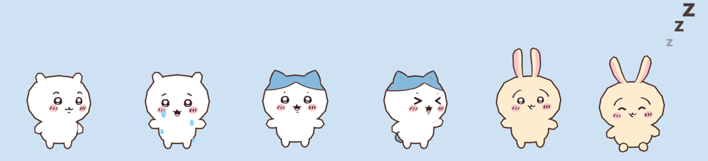

# Desktop Pet

Chiikawa, Hachiware and Usagi living on your desktop. They walk along the bottom of the screen on
top of every window, react when you click them, and can be picked up and dropped.



A fan project for personal use, built with [Electron](https://www.electronjs.org/) and
[three.js](https://threejs.org/). Made and tested on Windows 11.

## The 3D model

All three characters come from one model:

**"[chiikawa and friends](https://sketchfab.com/3d-models/chiikawa-and-friends-4c156cab855e451481829d25f4cf3bb1)"
by [Nini](https://sketchfab.com/bawangkun)**, licensed under
[CC-BY-NC-4.0](http://creativecommons.org/licenses/by-nc/4.0/): the author must be credited and
commercial use is not allowed.

It is included unchanged in [`chiikawa_and_friends/`](chiikawa_and_friends), with its original
[`license.txt`](chiikawa_and_friends/license.txt). The model is a static mesh with no skeleton or
animations; every movement and expression you see is produced by this app at run time (see
[How it works](#how-it-works)).

Chiikawa and its characters are created by Nagano. This project is not affiliated with or endorsed by
the author or the rights holders.

## Install

Download `Desktop-Pet-Setup-x.y.z.exe` from the
[latest release](https://github.com/frceapp/Desktop-Pet/releases/latest) and run it. It installs for
your user only (no administrator rights needed), adds a Start menu and desktop shortcut, and starts
the pets. Uninstall it from Windows Settings like any other app.

The installer is not code-signed, so Windows SmartScreen may say "Windows protected your PC" the
first time. Choose **More info**, then **Run anyway**.

## Run from source

You need [Node.js](https://nodejs.org/) 22.12 or newer.

```bash
npm install
npm start
```

The first start downloads Electron, so it takes a little longer. If Electron says it failed to
install, run `npx install-electron` once and start again.

### Build the installer

```bash
npm run dist
```

This writes `dist/Desktop-Pet-Setup-<version>.exe`.

To publish a new version on GitHub, raise `"version"` in `package.json`, commit, then push a tag
with the same number:

```bash
git tag v1.0.1
git push origin main v1.0.1
```

GitHub then builds the installer and attaches it to a new release (see
`.github/workflows/release.yml`).

three.js is copied into `renderer/vendor/three` so the installed app needs no `node_modules`; run
`npm run vendor` after updating it.

## What they do

- **Walk around** on the floor of your screen, legs stepping, arms swinging, ears flopping.
- **Fidget** when standing still: wave, cheer, look around, wiggle, blink, twitch an ear.
- **Talk** in little speech bubbles.
- **Chase the mouse.** Move the pointer near one and it runs over with its arms out, then jumps
  and grabs at it. It gives up after a few seconds, or when the pointer stops moving.
- **Keep each other company.** With more than one out they wander over to each other, and when
  two meet they stop to wave, chat or dance together. When one cries, the others come and stay
  beside it. When Usagi opens a black hole, the others nearby jump.
- **React to clicks.** Click one 5 times within 4 seconds and it snaps.
- **Get picked up.** Drag one anywhere; let go and it drops back to the floor.

| | Says | When it snaps |
| --- | --- | --- |
| **Chiikawa** | "wa…", "waa…!", "uwaa…", "un", "fu!" | Warns "iya…", then "yada!" with its eyes shut, then cries |
| **Hachiware** | "nantoka nareee!", "…tte koto!?" | Shouts "nantoka nareee!", then cries "naichatta!" |
| **Usagi** | "ura", "yaha", "fuun", "purya", "purururururu" | Warns "haa?", then yells "ura!!". It never cries. |

Usagi has two tricks of its own:

- **Black hole.** The third time it snaps, it opens a small black hole beside itself that swirls
  that patch of the screen for a few seconds.
- **Cracked screen.** Drop it from high up and the screen cracks where it lands, then heals.

Both are only pictures drawn on top of the screen; clicks pass straight through them. To bend the
screen, the black hole takes one picture of that small patch at the moment it opens. The picture
stays inside the app and is thrown away when the hole closes.

The pets make no sound.

## The menu

Right-click a character. Size, Stay, Sleep and Mute apply to the one you right-clicked.

| Item | What it does |
| --- | --- |
| **Characters** | Tick everyone you want on screen. Each one roams on its own. The last one cannot be unticked. |
| **Size** | Tiny, Small, Normal, Large, Huge |
| **Stay** | It sits down and stays exactly where you put it, even above the floor. It still grabs at the mouse but does not run after it. |
| **Sleep** | It sits, shuts its eyes and dozes with little z's until you untick it. Clicks do not wake it. |
| **Mute** | It keeps moving and reacting but shows no speech bubbles |
| **Open characters folder** | Opens the folder described under [Adding a character](#adding-a-character) |
| **Quit** | Closes every pet |

The tray icon has the same menu without the per-character items. Your choices are remembered
between starts.

## Adding a character

Each folder in `characters/` is one character, described by a `character.json`. New folders show up
in the Characters menu the next time you open it.

| Key | Meaning |
| --- | --- |
| `name` | Label shown in the Characters menu |
| `size` | Height of the pet in pixels at Normal size |
| `speed` | Walking speed, pixels per second |
| `annoyAfterClicks`, `clickWindowMs` | This many clicks within this many ms makes it snap |
| `cryMs` | How long it cries afterwards |
| `sprites` or `model` | How it is drawn, see below |
| `lines` | What its speech bubble says per situation, a list of texts each: `idle`, `click`, `warn` (one click before snapping), `annoyed`, `cry`, `comfort` (beside another pet that is crying), `special` (opening a black hole), `land` (cracking the screen). Leave `cry` out and it never cries. |
| `blackHole` | Optional. `afterTantrums`: it opens a black hole every this many times it snaps; `size` in pixels; `seconds` it lasts |
| `crack` | Optional. Dropped from at least `fromHeight` pixels it cracks the screen where it lands: `width`, `height` of the cracked patch, `seconds` it lasts |

### Drawn with images (`sprites`)

One image per state: `idle` (required), `walk`, `talk`, `annoyed`, `cry`, `drag`, `sit` (shown while
told to stay), `sleep`. SVG, PNG, GIF, APNG and WebP all work. Draw it facing right; it is mirrored
when walking left. Example: `"sprites": { "idle": "idle.png", "walk": "walk.gif" }`.

### Drawn from a 3D model (`model`)

A glTF file; no rig or animations needed. See `characters/chiikawa`.

| Key | Meaning |
| --- | --- |
| `file` | Path to the `.gltf`/`.glb`, relative to the character folder |
| `node` | Name of the node to show, when the file holds several characters |
| `yaw` | Degrees to turn the model if it does not face the camera |
| `tears` | Where tears start, as fractions of the figure: `x` sideways from the middle, `y` up from the feet |
| `expressions` | Per state (`neutral` for the everyday face, `talk`, `annoyed`, `cry`, `blink`, `sleep`; asleep it uses `blink` if there is no `sleep`), edits painted onto the face texture: `clear: [x, y, w, h]`, `copy: [sx, sy, w, h, dx, dy, dw?, dh?]`, `stroke: [width, [x, y], ...]`, in pixels of the texture image. An entry can also be the name of another list to start from, e.g. `"blink": ["neutral", ...]`. |

## How it works

- **One small window per pet.** Each is transparent, always on top and moves itself across the
  screen. Only the character itself catches the mouse; the rest of the window lets clicks through.
- **Movement without a skeleton.** The model is split into its separate solid pieces. Short pieces
  standing on the floor are legs, small pieces out at the sides are arms, and pieces either side of
  the top of the head are ears. Each is turned about its own joint every frame; the body as a whole
  turns, hops, leans and squashes.
- **Expressions without blend shapes.** The face is a texture holding eyes, eyebrows, cheeks and
  several mouths. For each expression the app paints an edited copy of it: swapping in another
  mouth, or drawing shut eyes.
- **Screen effects** are separate see-through windows that close themselves after a few seconds.

| File | Role |
| --- | --- |
| `main.js` | Windows, menu, tray icon, saved settings, screen effects |
| `renderer/pet.js` | What a pet decides to do: walk, talk, chase the mouse, react, fall, sleep |
| `renderer/model-view.js` | Draws a 3D-model character and animates it |
| `renderer/sprite-view.js` | Draws an image-based character |
| `renderer/blackhole.js`, `renderer/crack.js` | The two screen effects |
| `characters/` | One folder per character |

## Credits

- 3D model: "[chiikawa and friends](https://sketchfab.com/3d-models/chiikawa-and-friends-4c156cab855e451481829d25f4cf3bb1)"
  by [Nini](https://sketchfab.com/bawangkun), [CC-BY-NC-4.0](http://creativecommons.org/licenses/by-nc/4.0/).
- Chiikawa, Hachiware and Usagi are characters by Nagano.

Because the model's licence forbids commercial use, this project is for non-commercial use only.
