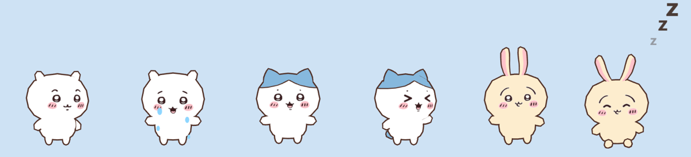

# Desktop Pet

Chiikawa, Hachiware and Usagi living on your desktop. They walk along the bottom of the screen on
top of every window, react when you click them, and can be picked up and dropped.



A fan project for personal use, built purely in **Native Rust** on top of Windows Win32 layered
windows (`windows-sys`), `tiny-skia`, `resvg`, `glam`, and `gltf` — with no browser, WebView, or
Node.js runtime. Made and tested on Windows 11.

## The 3D model

All three characters come from one model:

**"[chiikawa and friends](https://sketchfab.com/3d-models/chiikawa-and-friends-4c156cab855e451481829d25f4cf3bb1)"
by [Nini](https://sketchfab.com/bawangkun)**, licensed under
[CC-BY-NC-4.0](http://creativecommons.org/licenses/by-nc/4.0/): the author must be credited and
commercial use is not allowed.

It is included unchanged in [`chiikawa_and_friends/`](chiikawa_and_friends), with its original
[`license.txt`](chiikawa_and_friends/license.txt). The model is a static mesh with no skeleton or
animations; every movement and expression you see is produced by this app at run time (see
[How it works](#how-it-works)).

Chiikawa and its characters are created by Nagano. This project is not affiliated with or endorsed by
the author or the rights holders.

## Install

Download `Desktop-Pet-Windows-x64-vx.y.z.zip` from the
[latest release](https://github.com/frceapp/Desktop-Pet/releases/latest), extract it, and run
`desktop-pet.exe`. Keep the `characters/` and `chiikawa_and_friends/` folders next to the
executable.

The executable is not code-signed, so Windows SmartScreen may say "Windows protected your PC" the
first time. Choose **More info**, then **Run anyway**.

## Run from source

You need [Rust](https://www.rust-lang.org/tools/install) (MSVC toolchain on Windows) and the Windows
10/11 SDK.

```powershell
cargo run --release
```

### Build the release binary

```powershell
cargo build --release
```

This writes a single standalone executable to `target\release\desktop-pet.exe` (~3.8 MB).

To publish a new version on GitHub, raise `version` in `Cargo.toml`, commit, then push a tag with
the same number:

```bash
git tag v1.0.3
git push origin main v1.0.3
```

GitHub then builds and attaches `Desktop-Pet-Windows-x64-<tag>.zip` to a new release (see
`.github/workflows/release.yml`).

## What they do

- **Walk around** on the floor of your screen, legs stepping, arms swinging, ears flopping.
- **Fidget & dance** when standing still: wave, cheer, look around, wiggle, bow, stretch, tiptoe,
  spin-hop, peek over its shoulder while shaking its butt, or break into a full **butt-wiggle dance**,
  boogie, spin, or excited jump.
- **Talk** in little speech bubbles.
- **Chase the mouse.** Move the pointer near one and it runs over with its arms out, then jumps
  and grabs at it. It gives up after a few seconds, or when the pointer stops moving. You can
  switch this off per character in the menu.
- **Keep each other company.** With more than one out they wander over to each other, and when
  two meet they stop to wave, chat, or do synchronized partner dances (including butt-wiggle, boogie,
  and spin dances). Nearby pets also trot over to join a dancing friend in sync! When one cries,
  the others come and stay beside it. When Usagi opens a black hole, the others nearby jump.
- **React to clicks.** Click one 5 times within 4 seconds and it snaps.
- **Get picked up.** Drag one anywhere; let go and it drops back to the floor.

| | Says | When it snaps |
| --- | --- | --- |
| **Chiikawa** | "wa…", "waa…!", "uwaa…", "un", "fu!" | Warns "iya…", then "yada!" with its eyes shut, then cries |
| **Hachiware** | "nantoka nareee!", "…tte koto!?" | Shouts "nantoka nareee!", then cries "naichatta!" |
| **Usagi** | "ura", "yaha", "fuun", "purya", "purururururu" | Warns "haa?", then yells "ura!!". It never cries. |

Usagi has two tricks of its own:

- **Black hole.** The third time it snaps, it opens a small black hole beside itself that swirls
  that patch of the screen for a few seconds.
- **Cracked screen.** Drop it from high up and the screen cracks where it lands, then heals.

Both are only layered transparent overlays drawn on top of the screen; clicks pass straight through
them. To bend the screen, the black hole captures one patch of that region via Win32 GDI at the
moment it opens. The capture stays in memory and is discarded when the hole closes.

The pets make no sound.

## The menu

Right-click a character. Everything from Size to Chase mouse applies to the one you right-clicked.

| Item | What it does |
| --- | --- |
| **Control Panel...** | Opens the native character settings window with live Size & Walk Speed sliders, visibility toggles, behavior switches, Butt Dance!, Bring to Floor, and Reset Defaults |
| **Butt Dance!** | Makes the right-clicked pet turn around and perform its butt-wiggle dance (nearby pets may walk over and join!) |
| **Dance Party!** | Makes every pet on screen start a synchronized butt-wiggle dance party |
| **Characters** | Tick everyone you want on screen. Each one roams on its own. The last one cannot be unticked. |
| **Size** | Tiny, Small, Normal, Large, Huge |
| **Stay** | It sits down and stays exactly where you put it, even above the floor. It still grabs at the mouse but does not run after it. |
| **Sleep** | It sits, shuts its eyes and dozes with little z's until you untick it. Clicks do not wake it. |
| **Mute** | It keeps moving and reacting but shows no speech bubbles |
| **Chase mouse** | Ticked by default. Untick it and that character leaves the mouse pointer alone. |
| **Open characters folder** | Opens the folder described under [Adding a character](#adding-a-character) |
| **Quit** | Closes every pet |

The tray icon has the same menu without the per-character items. Your choices are remembered
between starts in `%APPDATA%\desktop-pet\settings.json`.

## Adding a character

Each folder in `characters/` is one character, described by a `character.json`. New folders show up
in the Characters menu the next time you open it.

| Key | Meaning |
| --- | --- |
| `name` | Label shown in the Characters menu |
| `size` | Height of the pet in pixels at Normal size |
| `speed` | Walking speed, pixels per second |
| `annoyAfterClicks`, `clickWindowMs` | This many clicks within this many ms makes it snap |
| `cryMs` | How long it cries afterwards |
| `sprites` or `model` | How it is drawn, see below |
| `lines` | What its speech bubble says per situation, a list of texts each: `idle`, `click`, `warn` (one click before snapping), `annoyed`, `cry`, `comfort` (beside another pet that is crying), `special` (opening a black hole), `land` (cracking the screen). Leave `cry` out and it never cries. |
| `blackHole` | Optional. `afterTantrums`: it opens a black hole every this many times it snaps; `size` in pixels; `seconds` it lasts |
| `crack` | Optional. Dropped from at least `fromHeight` pixels it cracks the screen where it lands: `width`, `height` of the cracked patch, `seconds` it lasts |

### Drawn with images (`sprites`)

One image per state: `idle` (required), `walk`, `talk`, `annoyed`, `cry`, `drag`, `sit` (shown while
told to stay), `sleep`. SVG, PNG, GIF, WebP, JPEG, BMP and ICO all work. Draw it facing right; it
is mirrored when walking left. Example: `"sprites": { "idle": "idle.png", "walk": "walk.gif" }`.

### Drawn from a 3D model (`model`)

A glTF/GLB file; no rig or animations needed. See `characters/chiikawa`.

| Key | Meaning |
| --- | --- |
| `file` | Path to the `.gltf`/`.glb`, relative to the character folder |
| `node` | Name of the node to show, when the file holds several characters |
| `yaw` | Degrees to turn the model if it does not face the camera |
| `tears` | Where tears start, as fractions of the figure: `x` sideways from the middle, `y` up from the feet |
| `expressions` | Per state (`neutral` for the everyday face, `talk`, `annoyed`, `cry`, `blink`, `sleep`; asleep it uses `blink` if there is no `sleep`), edits painted onto the face texture: `clear: [x, y, w, h]`, `copy: [sx, sy, w, h, dx, dy, dw?, dh?]`, `stroke: [width, [x, y], ...]`, in pixels of the texture image. An entry can also be the name of another list to start from, e.g. `"blink": ["neutral", ...]`. |

## How it works

- **One Win32 layered window per pet.** Each is transparent, always on top (`WS_EX_TOPMOST`), and
  never steals focus (`WS_EX_NOACTIVATE`). `WS_EX_TRANSPARENT` is toggled dynamically from the pet's
  body ellipse so clicks around the pet pass straight through.
- **2×2 SSAA software 3D rasterizer.** Unlit glTF meshes and mipmapped facial textures are rasterized
  directly on CPU into premultiplied BGRA DIB sections updated via `UpdateLayeredWindow`.
- **Movement without a skeleton.** The model is split into its separate solid pieces. Short pieces
  standing on the floor are legs, small pieces out at the sides are arms, and pieces either side of
  the top of the head are ears. Each is turned about its own joint every frame; the body as a whole
  turns, hops, leans and squashes.
- **Expressions without blend shapes.** The face is a texture holding eyes, eyebrows, cheeks and
  several mouths. For each expression the app paints an edited copy of it: swapping in another
  mouth, or drawing shut eyes.
- **Screen effects** are separate click-through layered windows that close themselves after a few
  seconds.

| File | Role |
| --- | --- |
| `src/main.rs` | DPI awareness, single-instance lock, entry point, unit tests |
| `src/win32_app.rs` | Win32 layered windows, tray icon, context menu, event loop, company behavior |
| `src/control_panel.rs` | Native character settings Control Panel window (sliders, toggles, live preview) |
| `src/pet.rs` | What a pet decides to do: walk, talk, chase the mouse, react, fall, sleep |
| `src/model_view.rs` | Loads glTF/GLB models, extracts limbs, paints expressions, animates |
| `src/raster3d.rs` | 2×2 SSAA unlit software 3D rasterizer & mipmap texture sampler |
| `src/sprite_view.rs` | Loads and draws image-based characters (`PNG`, `GIF`, `SVG`, `WebP`, etc.) |
| `src/ui_overlay.rs` | Native speech bubble and sleeping `z` overlay renderer |
| `src/effects.rs` | Black hole warp shader and procedural cracked screen effect |
| `src/config.rs` | `character.json` discovery & `settings.json` persistence |
| `characters/` | One folder per character |

## Credits

- 3D model: "[chiikawa and friends](https://sketchfab.com/3d-models/chiikawa-and-friends-4c156cab855e451481829d25f4cf3bb1)"
  by [Nini](https://sketchfab.com/bawangkun), [CC-BY-NC-4.0](http://creativecommons.org/licenses/by-nc/4.0/).
- Chiikawa, Hachiware and Usagi are characters by Nagano.

Because the model's licence forbids commercial use, this project is for non-commercial use only.
